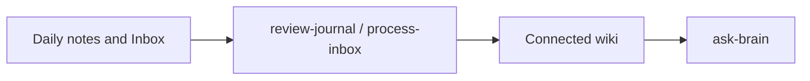

# ParaBrain

## What it is

ParaBrain is an Obsidian vault and a set of agent skills for people who want to turn notes and sources into a personal, connected wiki. Its name combines PARA (Projects, Areas, Resources, Archive) with "para-", meaning beside: a brain that works alongside you.

## How it works

- `1-Journal/`: daily notes and weekly and monthly summaries.
- `2-Inbox/`: sources waiting to be processed.
- `3-Projects/`, `4-Areas/`, `5-Resources/`, `6-Archive/`: the PARA wiki and owner documents.
- `7-Raw/`: processed sources and attachments.
- `8-System/`: your profile, limits and Obsidian templates.
- `index.md`, `log.md`, `questions.md`: the wiki map, operation history and knowledge gaps.
- `.agents/skills/` and `.agents/templates/`: agent procedures and page templates.

Location is the ledger: flat closed daily notes and Inbox files are pending; processed days move to dated Daily folders and Inbox sources are archived in `7-Raw/sources/`. Git keeps the vault's history. The agent previews changes and waits for your approval before writing.

Your own documents include pages marked `type: my-document` and Markdown pages in Projects, Areas, Resources or Archive without an agent page type, except project `Decisions.md` and `Log.md`. The agent processes them only when you ask, using `process-inbox`, and never edits or moves them on its own. They can move unedited with a whole archived project or area. `8-System/templates/My document.md` is an optional Obsidian template for them.

URL clips become immutable source cards with short excerpts; clips without a URL are kept whole. The sync commit preserves the full clip in Git history (`git log -- "2-Inbox/<file>"`), and later research can re-read that history or the URL. Wiki claims use footnotes linking to their sources.

## Daily use

- Start with `start-journey`: "Set up my vault." It records your profile, including writing style and grammatical gender preferences, in `8-System/about.md`.
- Capture in a daily note or put an article in `2-Inbox/`. The daily template offers optional reflection prompts you can fill in or delete. Ask `process-inbox`: "Process this article" or "Process my document about training."
- Each week, ask `review-journal`: "Review my week." It can also review a closed day or summarise a month.
- Ask `ask-brain` at any time: "What have I learned about training?"
- Use `manage-project`: "Start a newsletter project" or "Archive this finished project."
- Each month, ask `check-health`: "Check the health of my vault." It reports findings; repairs need a separate request and approval.

## Setup: local

1. On GitHub, choose **Use this template** to create a private repository, then clone it to your computer.
2. Open the cloned folder as an Obsidian vault.
3. Run Claude Code or Codex in that folder and ask it to run `start-journey`.

## Setup: other devices

- **Local only:** Use Obsidian and Claude Code or Codex on one computer.
- **With a phone:** Use a sync method that carries Markdown between devices, such as Obsidian Sync, iCloud, Syncthing or Git. Obsidian Sync does not reliably carry hidden folders such as `.agents/`, `.claude/` and `.git/`, so the agent machine should work from the Git clone. Avoid using two sync engines on the same folder.
- **Always-on machine:** Optionally run the agent on a server that syncs the vault and commits and pushes changes. Reach it remotely through an agent UI you trust. [Obsidian Headless](https://help.obsidian.md/sync/headless) is one option for server-side Sync.

## Privacy

- The model provider sees what the agent reads. Check the training-data setting for your Claude or ChatGPT account.
- Notes are plaintext on the machines and in the Git repository. Keep the repository private.
- Any remote agent UI or relay sees what passes through it. Check its telemetry and privacy policy.
- `.claude/settings.json` sets commit and PR attribution to empty strings so vault commits carry no agent attribution trailer. The vault history is yours.

## Updating

Updates are manual. Add the public template as an `upstream` Git remote, fetch it, and deliberately review and bring over changes to `.agents/`, `8-System/templates/`, `AGENTS.md`, `CLAUDE.md`, `.claude/settings.json` and `.obsidian/`. Never take content folders, `index.md`, `log.md`, `questions.md`, `8-System/about.md` or `README.md` from upstream.

## Credits

Inspired by Andrej Karpathy's LLM Wiki pattern and Tiago Forte's PARA method. Page craft, limits and setup questions were adapted from Super Brain by Wojtek Strzałkowski and Piotr Kacała (MIT).

## License

[MIT](LICENSE).
